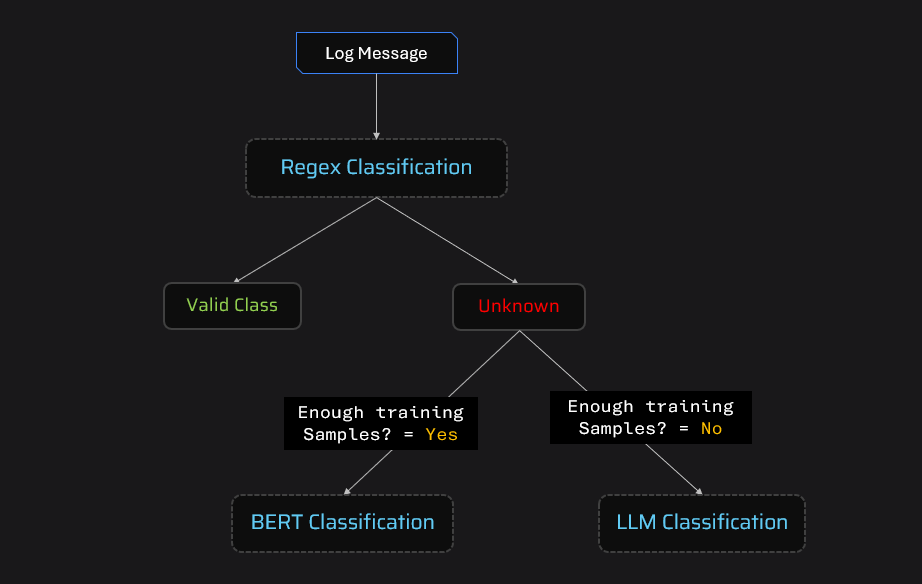

# 🔍 NLP Log Classification System

A hybrid log classification system that combines **Regex**, **Sentence Transformers + Logistic Regression**, and **LLM-based** approaches to intelligently classify log messages across varying complexity levels.

---

## ✨ Features

- **Multi-Strategy Classification** — Uses three complementary classification approaches for maximum accuracy
- **FastAPI Server** — Production-ready REST API for log classification
- **CSV Upload** — Simply upload a CSV file and get classified results back
- **Pre-trained Models** — Includes a ready-to-use trained model for immediate use

---

## 🏗️ Architecture

The system uses a **hybrid classification framework** that routes log messages through the most appropriate classifier:

| Approach | Best For | Details |
|----------|----------|---------|
| **Regex** | Simple, predictable patterns | Rule-based pattern matching for well-known log formats |
| **BERT + Logistic Regression** | Complex patterns with training data | Sentence Transformer embeddings fed into a Logistic Regression classifier |
| **LLM** | Complex patterns without labeled data | Large Language Model fallback for unstructured or rare log formats |



---

## 📁 Project Structure

```
├── server.py                  # FastAPI server with /classify endpoint
├── classify.py                # Core classification orchestration logic
├── processor_regex.py         # Regex-based classifier
├── processor_bert.py          # BERT + Logistic Regression classifier
├── processor_llm.py           # LLM-based classifier
├── requirements.txt           # Python dependencies
├── models/
│   └── log_classifier.joblib  # Pre-trained classification model
├── resources/
│   ├── arch.png               # Architecture diagram
│   ├── test.csv               # Sample test data
│   └── output.csv             # Sample output data
└── training/
    ├── log_classification.ipynb   # Model training notebook
    └── dataset/
        └── synthetic_logs.csv     # Training dataset
```

---

## 🚀 Getting Started

### Prerequisites

- Python 3.8+
- pip

### Installation

1. **Clone the repository**:
   ```bash
   git clone <your-repo-url>
   cd project-nlp-log-classification
   ```

2. **Install dependencies**:
   ```bash
   pip install -r requirements.txt
   ```

3. **Start the server**:
   ```bash
   uvicorn server:app --reload
   ```

4. **Access the API**:
   - API Endpoint: `http://127.0.0.1:8000/classify/`
   - Swagger Docs: `http://127.0.0.1:8000/docs`
   - ReDoc: `http://127.0.0.1:8000/redoc`

---

## 📖 Usage

### API Endpoint

**POST** `/classify/` — Upload a CSV file for classification.

**Input CSV format** (must contain these columns):

| source | log_message |
|--------|-------------|
| ModernCRM | IP 192.168.133.114 blocked due to potential attack |
| BillingSystem | User 12345 logged in |

**Output**: Returns a CSV file with an added `target_label` column containing the classification result.

### Command Line

You can also classify logs directly via the command line:

```bash
python classify.py
```

This reads from `test.csv` and outputs to `output.csv`.

---

## 🧠 How It Works

1. **Routing Logic** — The system checks the log source:
   - `LegacyCRM` logs → routed to the **LLM classifier** (handles unstructured legacy formats)
   - All other sources → first tries **Regex**, then falls back to **BERT classifier**

2. **Training** — The BERT-based classifier is trained using the Jupyter notebook in `training/log_classification.ipynb` on synthetic log data.

---

## 🛠️ Tech Stack

- **Python** — Core language
- **FastAPI** — Web framework for the REST API
- **Sentence Transformers** — For generating text embeddings
- **scikit-learn** — Logistic Regression classifier
- **Pandas** — Data manipulation
- **Uvicorn** — ASGI server

---

## 📄 License

This project is open source and available for personal and educational use.

---

## 👤 Author

**Lucky**

---

*Built with ❤️ using NLP and Machine Learning*
