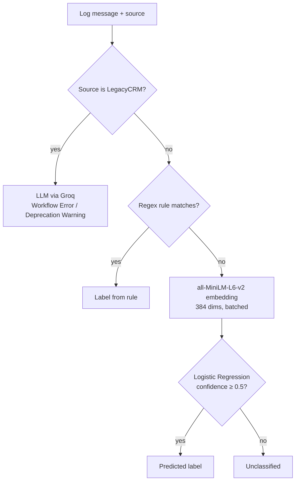

# Hybrid NLP Log Classification

[](https://github.com/CodesByLucky/NLP-Log-Classification/actions/workflows/tests.yml)


A log classification service that sends each log message to the **cheapest method that can label it reliably**: regex rules for fixed templates, sentence embeddings + Logistic Regression for sources with plenty of labeled data, and an LLM for a legacy source with almost none. It is served as a FastAPI endpoint that takes a CSV of logs and returns it labeled.

## Results

The embedding classifier (tier 2) on a 30% held-out split (571 logs, 5 classes):

| Class | Precision | Recall | F1 | Support |
|---|---|---|---|---|
| Critical Error | 0.91 | 1.00 | 0.95 | 48 |
| Error | 0.98 | 0.89 | 0.93 | 47 |
| HTTP Status | 1.00 | 1.00 | 1.00 | 304 |
| Resource Usage | 1.00 | 1.00 | 1.00 | 49 |
| Security Alert | 1.00 | 0.99 | 1.00 | 123 |
| **Accuracy / macro F1** | | | **0.99 / 0.98** | 571 |

How the 2,410 training logs split across tiers:

| Tier | Logs | Share | Why this tier |
|---|---|---|---|
| Regex rules | 500 | 20.7% | Fixed templates (backups, logins, uploads); no inference cost |
| Embeddings + Logistic Regression | 1,903 | 79.0% | Varied wording but plenty of labeled examples |
| LLM | 7 | 0.3% | LegacyCRM: too few examples to train a classifier |

## How it works



1. **Pattern discovery.** In the [training notebook](training/log_classification.ipynb), all logs are embedded with `all-MiniLM-L6-v2` and clustered with **DBSCAN** (cosine distance). Large, uniform clusters are fixed templates, so they become regex rules in [`processor_regex.py`](processor_regex.py).
2. **Regex tier.** Matching logs are labeled instantly, with no model calls.
3. **Embedding tier.** Remaining logs are embedded in a single batch and classified by Logistic Regression ([`processor_bert.py`](processor_bert.py)). Predictions below 0.5 confidence return `Unclassified` rather than a wrong label.
4. **LLM tier.** LegacyCRM logs go to an LLM on Groq with a constrained prompt; the answer is parsed from `<category>` tags and validated against the allowed labels ([`processor_llm.py`](processor_llm.py)).

**Labels:** HTTP Status, Security Alert, System Notification, Error, Resource Usage, Critical Error, User Action, Workflow Error, Deprecation Warning.

## Quick start

```bash
git clone https://github.com/CodesByLucky/NLP-Log-Classification.git
cd NLP-Log-Classification
python -m venv .venv && source .venv/bin/activate
pip install -r requirements.txt
cp .env.example .env          # add your GROQ_API_KEY
uvicorn server:app --reload
```

Open http://127.0.0.1:8000/docs for the interactive API docs.

### Classify a CSV

The CSV needs `source` and `log_message` columns:

```bash
curl -X POST http://127.0.0.1:8000/classify/ \
  -F "file=@resources/test.csv" -o classified_logs.csv
```

The response is the same CSV with a `target_label` column added (see [`resources/output.csv`](resources/output.csv)).

### Command line

```bash
python classify.py   # reads resources/test.csv, writes resources/output.csv
```

## Tests

The tests stub out the embedding model and the LLM, so they run in seconds with no API key or model download:

```bash
pip install -r requirements-dev.txt
pytest
```

## Project structure

```
├── server.py                 # FastAPI app: /classify/ and /health
├── classify.py               # Routing logic across the three tiers
├── processor_regex.py        # Tier 1: regex rules
├── processor_bert.py         # Tier 2: sentence embeddings + Logistic Regression
├── processor_llm.py          # Tier 3: LLM classification via Groq
├── models/log_classifier.joblib
├── training/
│   ├── log_classification.ipynb   # DBSCAN clustering, regex design, model training
│   └── dataset/synthetic_logs.csv # 2,410 labeled logs from 6 sources
├── resources/                # Sample input/output and architecture diagram
└── tests/
```

## Limitations and next steps

- The dataset is synthetic; real production logs would need re-clustering and retraining.
- Accuracy above covers the embedding tier only. An end-to-end evaluation across all three tiers is a next step, as is evaluating the LLM tier, which has only 7 labeled examples.
- The default LLM is `openai/gpt-oss-120b` on Groq (the original `deepseek-r1-distill-llama-70b` was retired by Groq). Set `GROQ_MODEL` to use another model.

## Tech stack

Python · Sentence Transformers (Hugging Face) · scikit-learn · DBSCAN · Groq LLM API · FastAPI · Pandas · pytest · GitHub Actions

## Author

**Lucky Samant** · [luckysamant.in](https://luckysamant.in) · [LinkedIn](https://www.linkedin.com/in/luckysamant/) · [GitHub](https://github.com/CodesByLucky)

This project is open source and available for personal and educational use.
